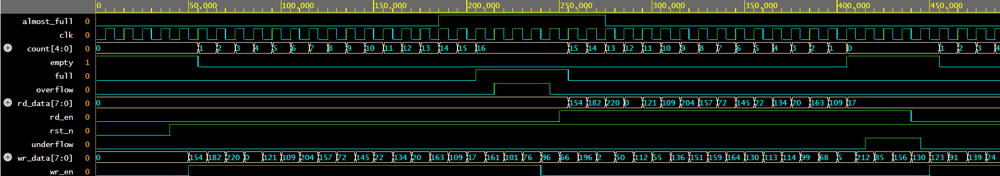
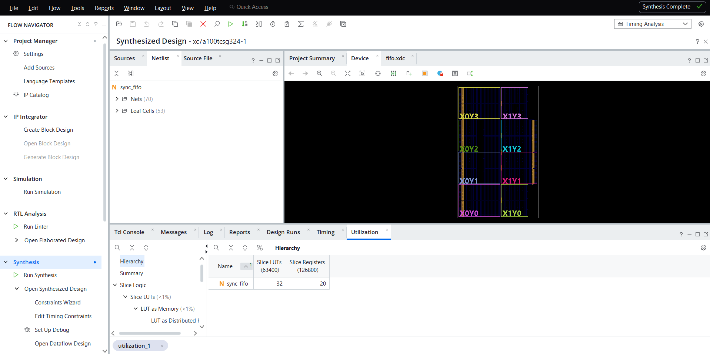
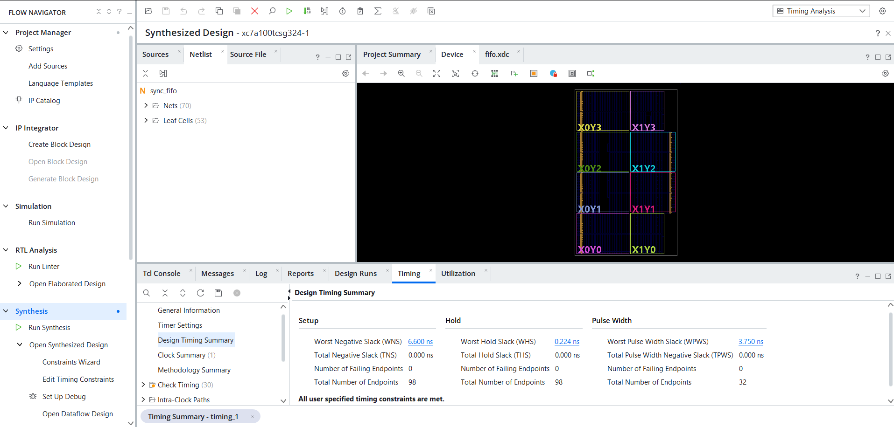

# Parameterized Synchronous FIFO with SystemVerilog Assertions

A configurable single-clock FIFO in SystemVerilog, verified with a self-checking
testbench, a reference-model scoreboard, functional coverage and 25+ SVA
properties attached through `bind`.

## Features

- Parameterized `DATA_WIDTH`, `DEPTH` (power of 2) and almost-full/empty thresholds
- Full/empty detection using (N+1)-bit pointers (extra MSB trick), no extra counter register
- Occupancy `count` output
- Registered read data (1-cycle read latency)
- Writes while full / reads while empty are safely ignored and flagged with `overflow` / `underflow` pulses
- Active-low asynchronous reset
- Memory array has no reset, so it maps onto FPGA distributed/block RAM

## Block Diagram

```
             +-------------------------------------------+
 wr_en  ---->|  wr_fire = wr_en & !full                  |
 wr_data --->|        |                                  |
             |   +----v-----+      +-----------------+   |
             |   |  wr_ptr  |----->|  mem[DEPTH]     |   |
             |   | (AW+1 b) |      |  DATA_WIDTH b   |---+--> rd_data (registered)
             |   +----------+      +-----------------+   |
             |        |                     ^            |
             |   +----v-------------+  +----+-----+      |
             |   | full / empty /   |<-|  rd_ptr  |<-----+--- rd_en
             |   | count / almost_* |  | (AW+1 b) |      |    (rd_fire = rd_en & !empty)
             |   +------------------+  +----------+      |
             +-------------------------------------------+
```

## Interface

| Signal         | Dir | Width            | Description                                   |
|----------------|-----|------------------|-----------------------------------------------|
| `clk`          | in  | 1                | Clock                                         |
| `rst_n`        | in  | 1                | Asynchronous active-low reset                 |
| `wr_en`        | in  | 1                | Write request                                 |
| `wr_data`      | in  | DATA_WIDTH       | Write data                                    |
| `rd_en`        | in  | 1                | Read request                                  |
| `rd_data`      | out | DATA_WIDTH       | Read data, valid the cycle after an accepted read |
| `full`         | out | 1                | FIFO holds DEPTH entries                      |
| `empty`        | out | 1                | FIFO holds no entries                         |
| `almost_full`  | out | 1                | `count >= ALMOST_FULL_TH`                     |
| `almost_empty` | out | 1                | `count <= ALMOST_EMPTY_TH`                    |
| `overflow`     | out | 1                | 1-cycle pulse: write attempted while full     |
| `underflow`    | out | 1                | 1-cycle pulse: read attempted while empty     |
| `count`        | out | log2(DEPTH)+1    | Number of stored entries                      |

## Parameters

| Parameter         | Default     | Description                              |
|-------------------|-------------|------------------------------------------|
| `DATA_WIDTH`      | 8           | Width of each entry                      |
| `DEPTH`           | 16          | Number of entries (power of 2, >= 2)     |
| `ALMOST_FULL_TH`  | DEPTH - 2   | Threshold for `almost_full`              |
| `ALMOST_EMPTY_TH` | 2           | Threshold for `almost_empty`             |

## Design Notes

**Full vs empty.** Pointers are one bit wider than the address. When all bits
match, the FIFO is empty. When the address bits match but the MSBs differ, the
write pointer has wrapped once more than the read pointer, so the FIFO is full.
`count = wr_ptr - rd_ptr` falls out of the same arithmetic.

**Simultaneous read and write.** Both are accepted in the same cycle when the
FIFO is neither full nor empty, and `count` stays constant. When full, only the
read is accepted; when empty, only the write is accepted.

## Verification

### Testbench (`tb/tb_sync_fifo.sv`)

- **Scoreboard:** a SystemVerilog queue acts as the reference model. Every
  cycle, the checker compares `rd_data`, `count`, all four flags and both error
  pulses against the model.
- **Directed tests**

| Test | Scenario                                              |
|------|-------------------------------------------------------|
| T1   | Reset state                                           |
| T2   | Fill to full, then 3 writes while full (overflow)     |
| T3   | Drain to empty, then 3 reads while empty (underflow)  |
| T4   | 50 cycles of simultaneous read/write at half full     |
| T5   | Simultaneous read/write while full                    |
| T6   | Simultaneous read/write while empty                   |
| T7   | 10,000 random cycles: write-heavy, read-heavy, balanced |
| T8   | Reset asserted in the middle of traffic               |

- **Functional coverage:** covergroup on operation type × fill level
  (empty / low / high / full), plus almost-full and almost-empty.
- **Seed control:** run with `+SEED=<n>` for different random sequences.

### Assertions (`sva/sync_fifo_sva.sv`)

Bound to the DUT with `bind`, so the RTL is untouched.

| Category              | Properties checked                                                   |
|-----------------------|----------------------------------------------------------------------|
| Reset                 | FIFO empty, flags cleared after reset                                |
| Flag consistency      | never full and empty together; full/empty/almost flags match count   |
| Overflow protection   | write pointer frozen on write-when-full; `overflow` pulse correct    |
| Underflow protection  | read pointer frozen on read-when-empty; `underflow` pulse correct    |
| Pointer behaviour     | pointers increment exactly once per accepted op, hold otherwise      |
| Occupancy             | count +1 on write, -1 on read, unchanged on both/idle                |
| X-checks              | no X/Z on status outputs or on `rd_data` after a read                |
| Cover properties      | full, empty-to-full, full-to-empty, pointer wrap, R/W at boundaries  |

## How to Run

**Questa / ModelSim** (free Questa Starter edition with Intel Quartus works):
```
cd sim
vsim -c -do run_questa.do
```

**Vivado simulator (xsim):**
```
cd sim
sh run_xsim.sh
```

**EDA Playground (no install):** paste the three `.sv` files, choose
Aldec Riviera-PRO or Siemens Questa, and tick "Open EPWave after run".

Waveforms are dumped to `sync_fifo.vcd` (viewable in GTKWave).

## Results

| Metric                    | Value |
|---------------------------|-------|
| Simulator                 | Questa 2025.2 (EDA Playground) |
| Random cycles simulated   | 10,000 |
| Scoreboard errors         | 0 |
| Assertion failures        | 0 |
| Functional coverage       | 100 % |
| FPGA part                 | xc7a100tcsg324-1 (Arty A7-100T) |
| Synthesis tool            | Vivado (post-synthesis results) |
| Slice LUTs / FFs          | 32 / 20 |
| Timing (10 ns clock)      | WNS +6.600 ns, all constraints met |
| Fmax (estimate)           | ~294 MHz |





Full simulation log: [sim/sim_log.txt](sim/sim_log.txt)

## Project Structure

```
sync_fifo/
├── rtl/sync_fifo.sv        # Design
├── sva/sync_fifo_sva.sv    # Assertions + bind
├── tb/tb_sync_fifo.sv      # Self-checking testbench
├── sim/run_questa.do       # Questa/ModelSim script
├── sim/run_xsim.sh         # Vivado xsim script
└── README.md
```